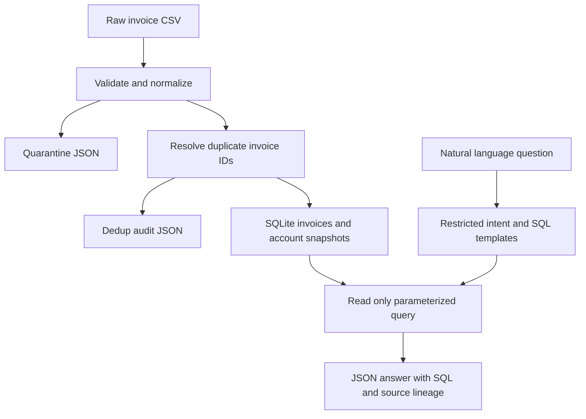

# Implemented architecture

`app.pipeline.build` creates the store and audit artifacts. `app.query.plan` maps explicitly supported question wording to reviewed SQL; `ask` executes it through a read-only authorized SQLite connection. `python -m app` rebuilds the store and prints six answers (or one `--ask` answer). No vector store, external LLM, web service, or frontend is implied.
